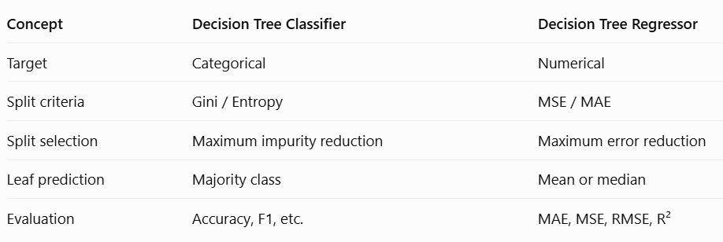

# Decision Tree Regressor (DTR) --- Step-by-Step Procedure

## 1. What is Decision Tree Regression?

A Decision Tree Regressor predicts a **numerical value** by dividing the
feature space into smaller regions (also called leaves).

For example, we can predict a house price using its size.

-   **Feature (X):** House size in square feet
-   **Target (y):** House price in ₹ lakhs
-   **Problem:** Regression, because the target is numerical

Unlike a Decision Tree Classifier, a Decision Tree Regressor does not
predict categories such as Yes or No.

## 2. Example dataset

Let's create small dataset for the explanation.

    House size (sq. ft.)   Price (₹ lakhs)
  ---------------------- -----------------
                     500                20
                     600                25
                     700                30
                     800                35
                     900                40
                    1000                45
                    1100                50
                    1200                55

The tree must learn rules that use house size to predict price.

## 3. Does a regression tree use Entropy?

**No. A standard Decision Tree Regressor does not use Entropy or
Information Gain.**

Entropy is commonly used to measure class impurity in classification.
Regression targets are numerical, so regression trees use criteria such
as:

-   **Squared error (MSE):** chooses splits that reduce squared
    prediction error.
-   **Absolute error (MAE):** uses absolute deviations.
-   **Friedman MSE:** a related squared-error improvement criterion.
-   **Poisson deviance:** for suitable non-negative targets.

In this walkthrough, we use `squared_error`, the default criterion in
scikit-learn's `DecisionTreeRegressor`.

## 4. How does the tree choose a split?

At a node, the algorithm considers possible feature thresholds. For each
candidate threshold, it divides the records into left and right groups
and measures the prediction error remaining in those groups.

For squared error, the prediction at a node is the **mean target value**
of the records in that node.

The Mean Squared Error at a node is:
```math
MSE = \frac{1}{n}\sum_{i=1}^{n}(y_i-\bar{y})^2
```
Where:
- `y_i` is an actual target value.
- `\bar{y}` is the mean target value in that node.
- `n` is the number of records in that node.
For a candidate split, the weighted child error is:
```math
MSE_{\text{split}} = \frac{n_L}{n} MSE_L + \frac{n_R}{n} MSE_R
```

The tree chooses the split with the **lowest weighted child MSE**
(equivalently, the greatest reduction in squared error relative to the
parent).

## 5. Worked example: split at 750 sq. ft.

Consider the candidate rule:

`House_Size <= 750`

It creates two groups.

### Left child

House sizes: 500, 600, 700

Prices: 20, 25, 30

Mean price:

```math
\bar{y}_L = \frac{20+25+30}{3} = 25
```

MSE:

```math
MSE_L = \frac{(20-25)^2+(25-25)^2+(30-25)^2}{3}
= \frac{50}{3} \approx 16.67
```

### Right child

House sizes: 800, 900, 1000, 1100, 1200

Prices: 35, 40, 45, 50, 55

Mean price:

```math
\bar{y}_R = \frac{35+40+45+50+55}{5} = 45
```

MSE:

```math
MSE_R = \frac{(35-45)^2+(40-45)^2+(45-45)^2+(50-45)^2+(55-45)^2}{5}
```

```math
MSE_R = \frac{250}{5} = 50
```

### Weighted MSE for this split

There are 8 records in total: 3 on the left and 5 on the right.

```math
MSE_{\text{split}} = \frac{3}{8}(16.67) + \frac{5}{8}(50) \approx 37.5
```

This is the weighted error remaining after this particular split. The
algorithm compares it with the weighted error from other candidate
thresholds and chooses the best one.

**Important:** The split at 750 is an illustrative candidate
calculation. The algorithm does not automatically choose it just because
we calculated it. It compares all valid candidate splits.

## 6. How many times is MSE calculated?

There is no fixed number.

-   At the root, the algorithm evaluates multiple candidate splits.
-   After choosing the best split, it repeats the process in each child
    node.
-   It continues recursively until a stopping condition is met.

The number of candidate splits depends on the data, number of features,
feature values, and tree constraints such as `max_depth`,
`min_samples_split`, and `min_samples_leaf`.

MSE is evaluated for candidate splits; it is not calculated only once
for the entire tree.

## 7. What does a leaf node predict?

With `criterion="squared_error"`, a leaf predicts the **mean target
value** of the training samples that reach that leaf.

For example:

  Prices in a leaf (₹ lakhs)     Prediction (mean)
  ---------------------------- -------------------
  20, 25, 30                                    25
  35, 40, 45                                    40
  50, 55                                      52.5

A new house is passed through the tree's rules. The mean value stored in
the leaf it reaches becomes its prediction.

## 8. Why does the regression plot look like steps?

A Decision Tree Regressor does not fit one straight line across the
whole dataset.

Each leaf predicts one constant value. Therefore, when house size
changes but the record remains in the same leaf, the prediction stays
the same. At a split threshold, the prediction may jump to another
leaf's value.

This creates a **step-shaped, piecewise-constant prediction curve**.

-   Scatter points represent actual observations.
-   Horizontal segments represent the tree's predictions.
-   Each horizontal segment corresponds to a region (leaf) of the
    feature space.

## 9. Complete scikit-learn implementation

``` python
import numpy as np
import matplotlib.pyplot as plt
from sklearn.tree import DecisionTreeRegressor, plot_tree

# Input feature: house size
X = np.array([
    500, 600, 700, 800,
    900, 1000, 1100, 1200
]).reshape(-1, 1)

# Target: house price in lakhs
y = np.array([20, 25, 30, 35, 40, 45, 50, 55])

# Create and train the Decision Tree Regressor
model = DecisionTreeRegressor(
    criterion="squared_error",
    max_depth=3,
    random_state=42
)

model.fit(X, y)

# Plot the tree structure
plt.figure(figsize=(14, 7))
plot_tree(
    model,
    feature_names=["House_Size"],
    filled=True,
    rounded=True
)
plt.title("Decision Tree Regressor")
plt.show()

# Create many input values so the prediction curve looks continuous
X_grid = np.linspace(450, 1250, 800).reshape(-1, 1)
y_pred = model.predict(X_grid)

# Plot actual values and tree predictions
plt.figure(figsize=(10, 6))
plt.scatter(
    X.ravel(), y,
    label="Actual house prices",
    s=65
)

plt.step(
    X_grid.ravel(), y_pred,
    where="post",
    label="Decision Tree prediction",
    linewidth=2
)

plt.xlabel("House size (sq. ft.)")
plt.ylabel("Price (₹ lakhs)")
plt.title("Decision Tree Regression: Step-Shaped Predictions")
plt.legend()
plt.grid(True)
plt.show()
```

## 10. Important parameters to control tree complexity

  -----------------------------------------------------------------------
  Parameter                           Purpose
  ----------------------------------- -----------------------------------
  `max_depth`                         Limits the maximum depth of the
                                      tree.

  `min_samples_split`                 Sets the minimum number of samples
                                      required to split a node.

  `min_samples_leaf`                  Sets the minimum number of samples
                                      allowed in a leaf.

  `max_leaf_nodes`                    Limits the total number of leaf
                                      nodes.

  `criterion`                         Chooses the regression error
                                      criterion, such as squared error or
                                      absolute error.
  -----------------------------------------------------------------------

A very deep tree can create many small leaves and may overfit the
training data. Limiting the tree's complexity can help it generalize
better.

## 11. Classification vs. Regression

  

  Example                 Predict Yes/No          Predict house price
  -----------------------------------------------------------------------

## 12. Classroom takeaway

1.  A Decision Tree Regressor predicts numerical values.
2.  It does not use Entropy or Information Gain.
3.  With `squared_error`, it evaluates candidate splits using weighted
    squared error.
4.  It selects the split that gives the greatest reduction in error.
5.  It repeats the process in child nodes.
6.  Each leaf predicts the mean target value of its training samples.
7.  Its prediction plot is step-shaped, not one straight line.

**Remember:** Classification trees separate classes; regression trees
divide the data into regions and predict a numerical value for each
region.
